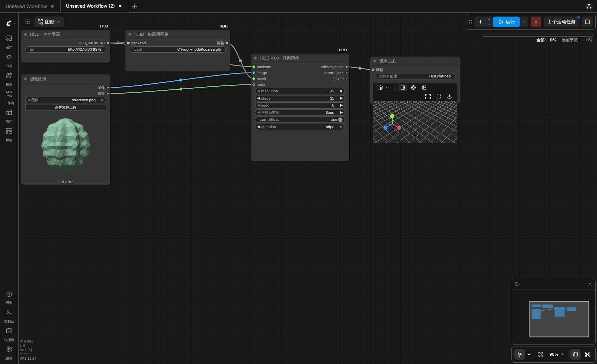
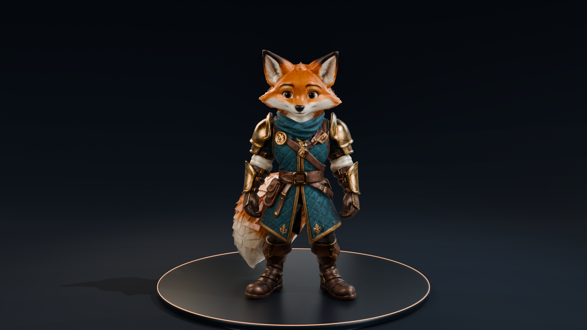

# Hi3D T8

[English](README.md) | **简体中文**

**By T8star** — Hi3D V1.0 ComfyUI 几何精修节点与独立本地 3D 工作台。

**ComfyUI 节点**只复现官方 Hi3D：输入**同一物体的参考图＋粗网格**，输出精修几何；节点接口与画布工作流保持不变。**独立整合包 v0.4**另支持单图生成几何、多种建模／PBR 引擎选择，以及同灯光下的历史结果对比。已验证范围见 [roadmap.md](roadmap.md)。

[模型下载](https://huggingface.co/t8star/Hi3d-Comfy) · [画布工作流](examples/Hi3D-Refine.json) · [验证记录](VALIDATION.md) · [Hi3D 原项目](https://github.com/hi3d-official/Hi3Dv1.0)



## ComfyUI

1. Registry 版本可用后，在 ComfyUI-Manager 搜索 **Hi3D T8**（节点 ID：`hi3d-t8`，Publisher：`t8star`）安装；也可克隆本仓库到 `ComfyUI/custom_nodes/Comfyui-Hi3d-T8`，使用 ComfyUI 自身 Python 安装 `requirements.txt`。
2. 启动**独立的本地工作台后端**，等待 `http://127.0.0.1:8378` 显示模型校验通过，安装方法见[本地工作台](#本地工作台)。
3. 将 [Hi3D-Refine.json](examples/Hi3D-Refine.json) 拖入 ComfyUI **画布**。这是包含节点位置和连线的可视化工作流，不是 API 格式。在 **Load Image** 上传参考图，在 **Hi3D Load Mesh** 填写粗网格的本机绝对路径。
4. 建议从 **512 / 25 步 / CPU 卸载**开始。Windows 选择 `sdpa`，官方 Linux 环境选择 `flash`，点击运行。原生 **SaveGLB** 将结果保存到 ComfyUI 输出目录。

三个自定义节点为 **Hi3D Backend、Hi3D Load Mesh、Hi3D Refine**，使用 ComfyUI 原生 `MESH`。后端与 ComfyUI 运行在同一台电脑；节点包不安装或替换 ComfyUI 的 PyTorch/CUDA。详见[节点说明](docs/COMFYUI.md)。

## 模型与两个版本的区别

| 组件 | 用途 | 使用范围 |
|---|---|---|
| Hi3D transformer 512＋VAE | 512 精修 | ComfyUI 和工作台共用 |
| Hi3D transformer 1024＋同一 VAE | 1024、1536 精修；没有独立 1536 权重 | ComfyUI 和工作台共用 |
| DINOv2 Large＋CLIP ViT-L/14 | Hi3D 必需图像编码器，不是额外 3D 模型 | ComfyUI 和工作台共用 |
| Hunyuan3D-2mini-Turbo／Hunyuan3D 2.1／TRELLIS.2 | 可选的图片建模引擎 | 仅独立整合包 |
| TRELLIS.2 PBR／Hunyuan3D-Paint 2.1／UltraTex | 可选的已有模型 PBR 引擎 | 仅独立整合包 |
| DINOv3、DINOv2 Giant、FLUX.2 Klein 9B 和 Qwen3 | 按所选扩展引擎安装的依赖 | 仅独立整合包 |
| CPU U2Netp | 不透明图片的可选前景提取 | 仅独立整合包 |

[Hugging Face 模型仓库](https://huggingface.co/t8star/Hi3d-Comfy)提供两版共用的 **Hi3D 核心权重与配置，未修改或量化**，没有专供 ComfyUI 的另一套权重。整合包新增模型单独放在 `models/extensions`，从固定版本的上游或公开分发仓库下载，并分别保留许可。Registry / 节点包只包含**代码和画布工作流**；单独下载权重不等于具备推理环境。

在**工作台根目录**执行，权重无需放进 `ComfyUI/models`：

```bash
hf download t8star/Hi3d-Comfy --local-dir models
```

目录应为 `models/manifest.json`、`models/hi3d/`、`models/dino/`、`models/clip/`。清单记录原始仓库版本与 SHA256。后端也支持直接从官方原仓库下载。

<details>
<summary>实际贴图样例</summary>



独立工作台实测：TRELLIS.2 建模＋UltraTex PBR；本例未启用 Hi3D 精修。

</details>

## 本地工作台

Windows 版双击 **Start-Workbench.cmd**，打开 `http://127.0.0.1:8378`，可脱离 ComfyUI 使用。工作台提供三个入口：图片→基础模型→可选 Hi3D 精修→PBR；参考图＋已有模型→PBR；参考图＋粗模→Hi3D，可选继续贴图。图片模式默认**基础模型＋PBR**，Hi3D 按需勾选：同图卡通对照中，跳过精修的嘴部更干净。各阶段保留模型、日志和报告。建模与贴图引擎独立选择，可在“模型”页按需下载。上传的自包含 GLB 保留材质和可用的单材质 UV；历史结果可在同视角、HDR 灯光与曝光下左右对比。选择建议见[引擎与质量记录](docs/ENGINES.zh-CN.md)。带材质结果使用自包含 **GLB**；**STL/PLY 只包含几何**。

v0.4 Windows 包内含两套隔离运行时，以及 **Hi3D 核心、Mini Turbo、TRELLIS.2 几何／PBR、DINOv3 和 CPU U2Netp**；六个扩展组件的准确清单见 `bundle-manifest.json`。**Hunyuan3D 2.1、Hunyuan Paint 和 UltraTex 权重需在“模型”页另行下载**。所选引擎未就绪时会明确提示，不会自动替换。节点包和源码包只含代码，源码部署需另行准备环境与权重。

提供三个起点：**轻量**为 Mini Turbo 256＋TRELLIS PBR 512／2K；**均衡**为 TRELLIS 几何 512＋PBR 1024／4K；**细节**为 TRELLIS 几何 1024＋UltraTex 1024／4K，需先下载其可选依赖。UltraTex 的 FLUX.2 Klein 9B 底座适用**非商业许可**。调大输出贴图尺寸不会补出生成中缺失的细节。详见[引擎选择](docs/ENGINES.zh-CN.md)和[工作台说明](docs/WORKBENCH.zh-CN.md)。

Windows 源码安装使用 Python 3.10 和独立环境：

```powershell
git clone https://github.com/T8mars/Comfyui-Hi3d-T8.git
cd Comfyui-Hi3d-T8
powershell -ExecutionPolicy Bypass -File scripts/Setup.ps1 -Python C:/Python310/python.exe -DownloadModels
```

独立工作台的图生／贴图阶段还需用 Python 3.12 执行 `C:/Python312/python.exe tools/setup_pipeline_runtime.py`，再执行 `.venv/Scripts/python.exe -m hi3d_workbench.pipeline_models download` 安装基础扩展模型。其他引擎在“模型”页单独下载，见[引擎说明](docs/ENGINES.zh-CN.md)。

Linux Hi3D 精修可执行 `bash scripts/setup-linux.sh`，再运行 `.venv/bin/python -m hi3d_workbench.model_cli download` 和 `.venv/bin/python -m hi3d_workbench --open`。Linux 脚本面向官方 Ampere/Hopper 环境，尚未在本机验收；新增图生／PBR 运行时目前只在 Windows 验证。更多操作见[工作台详细说明](docs/WORKBENCH.zh-CN.md)。

## 验证与限制

实测设备为 **Windows / RTX 5090 Laptop 24GB / 64GB RAM**。本轮多引擎推理、独立运行时检查及待验收项见 [VALIDATION.md](VALIDATION.md)；此前 ComfyUI 512 和独立工作台 512/1024/1536 精修实测保留为历史证据。自动化测试、HTTP 推理与浏览器操作分别记录。尚未验证更小显存设备；张量分配峰值不能作为最低显存要求。

Windows 使用明确标识的 **SDPA 兼容适配**，与官方 Linux FlashAttention 环境有区别。Hi3D 会归一化尺寸并重建拓扑；不保证结果封闭、可打印或比粗模更准确，导出前应对比检查。

随包 TRELLIS Windows 扩展要求 **CUDA 计算能力≥8.6**，因此该阶段不支持 RTX 20 系列或 A100（8.0）。通过架构检查不代表显存足够或该型号已经验收。

## 许可与署名

原创集成代码使用 [MIT](LICENSE)；UltraTex 在独立工作台运行时内另使用 GPL-3.0 的 Comfy 推理库与 **FLUX 非商业许可**底座，分别保留其许可；Hi3D 代码与权重使用 **Hi3D Open License v1.0** 并保留原始声明，编码器与运行时分别遵循各自许可。本项目为社区集成，详见 [NOTICE.md](NOTICE.md)。[Powered by Hi3D 1.0](https://www.hi3d.ai/)。

## T8star

[B站](https://space.bilibili.com/385085361) · [YouTube](https://www.youtube.com/@T8star-Aix/) · [API](https://api.seedance.nz/sign-up?aff=5f4w) · [免费画廊](https://www.openzhenzhen.com) · [在线 AI 应用](https://www.runninghub.ai/zh-cn/user-center/1907375370302308353/userPost?inviteCode=rh-v1121) · [ComfyUI 整合包](https://pan.quark.cn/s/264edb7e36bd) · [Hugging Face](https://huggingface.co/t8star)
