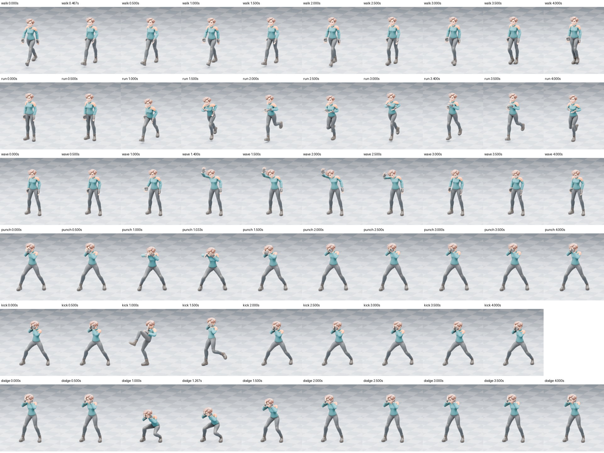
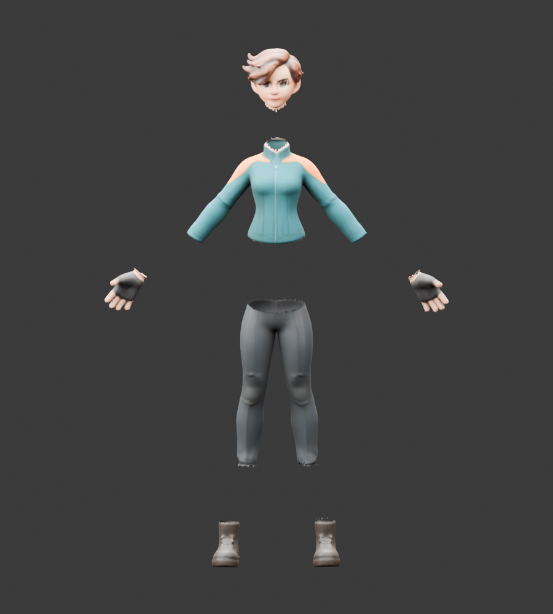
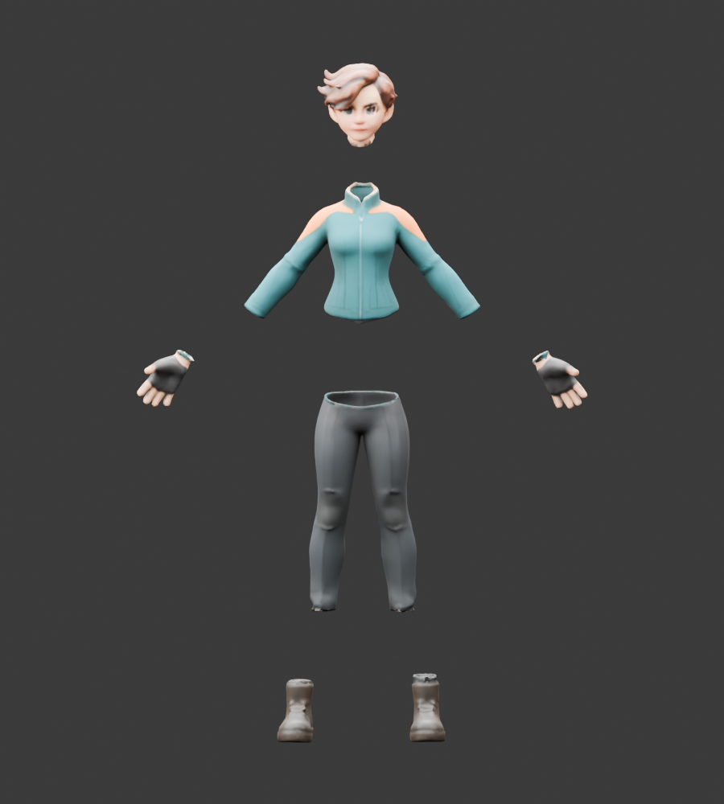

# 资产加工与单人动画

[English](ASSET_STUDIO.md) | **简体中文**

**v0.6.0 候选版，网页最终验收尚未完成。** 本地完整目录已包含三套 Python 环境、所选模型和演示素材，通过离线冷启动检查、真实 HTTP 加工和 EXE 启停验证。详见[完整包验证](../validation/asset-studio-portable-0.6.0.json)与[路线图](../roadmap.md#当前实施进展未完成交付)。这些功能仅属于独立工作台；ComfyUI 节点继续只运行 Hi3D 几何精修。

| 入口 | 后端 | 输出与用途 |
| --- | --- | --- |
| 保材质减面 | meshoptimizer | 按目标三角面数或比例减面，保留可用原 UV、贴图和属性；误差保护可能使实际面数高于目标。 |
| 四边面重拓扑 | AutoRemesher / Blender QuadriFlow + CPU／GPU UV + CPU 材质转移 | GLB 提供带新 UV/PBR 的三角网格，OBJ 保留四边面及其他多边形；两者的面数口径不同。 |
| AI 自动拆件 | P3-SAM | 分割原表面，支持选择、新建、合并、重命名、笔刷修正部件；下载组合 GLB 和独立部件 ZIP。 |
| 部件补全 | X-Part 公开轻量版 | 根据已修正的部件重新生成隐藏几何，保留原分割；新内部表面材质从对应原部件推测转移。 |
| 自动骨骼与蒙皮 | SkinTokens / UniRig | 生成骨架与权重，或保留已有骨架重新蒙皮；可修正静止关节，再检查变形。 |
| 部件固定到骨骼 | 显式刚性绑定，无额外 AI 模型 | 将已分离的尾巴、盔甲或配件完整固定到选定关节，保留原绑定文件。 |
| 动作导入与重定向 | BVH / FBX / 动画 GLB | 识别动作骨架及片段，校准映射、坐标、尺度和静止姿态，适配已绑定角色。 |
| AI 单人动作 | Kimodo-SOMA-RP-v1.2 | 文字生成动作，支持时长、种子、身体关键姿态与路径；输出动画 GLB、FBX 和动作 BVH。 |

## 操作顺序

1. 在资产加工页面上传 GLB，或选择已有任务成品。已有模型不需要先重新图生建模。
2. 按需要减面或重拓扑，检查实际面数、轮廓、细部和贴图。重拓扑会改变顶点，已有骨骼与动画不能直接沿用；原文件保留。
3. 拆件后检查三维部件，修正过粗或过细的划分。球形笔刷会影响背面的面；半径为 0 时可逐面修正。
4. 人体或人形角色先自动绑定，检查关节位置及肩肘、膝盖和衣物变形。已有骨架可选择重新蒙皮。
   优先使用四肢分开的 T／A 姿态。手贴腰、交叉腿或与衣物融合的表面可能拉扯；接触分离可能露出原本被遮挡的切口，不能把自动绑定成功视为动作质量已通过。
   四肢与衣物、左右腿之间出现长条拉扯时，可尝试“修正四肢与衣物的粘连”。它使用已有 AI 骨骼权重划分疑似接触处，保护肩髋附近的正常混合权重，保留原三角面、UV、材质和骨架；原始绑定 GLB 可另行下载。分离处可能开放，不能替代打印补面或修复全部蒙皮误判。
   对不应随腿部弯曲的尾巴或配件，可先拆件／用部件笔刷分离并保存，再选择“部件固定到骨骼”，指定部件及关节后添加绑定。该操作将整个部件固定到一个关节，不会生成自然摆尾或布料运动；其他部件保留原权重。已保存的部件名称和归属会随绑定与动作加工保留。
   如附件在动作中穿地，可勾选“动作时避免附件穿地”。它增加独立附件关节，在后续动作中向上转动以避开鞋底地面；原身体关节保持。此选项不处理身体、武器或场景物体之间的碰撞，无法避地时会报告。
5. 上传动作，或填写动作描述。核对来源／目标骨骼映射，再选择速度、循环、原地／保留位移及脚部接触修正。
   脚部修正使用实际蒙皮后的鞋底；即使来源动作暂时漏标接触，也会修正鞋底穿地，并保留正常腾空。它不处理全身或场景碰撞。
6. 预览完整动作和多个视角后下载成品。BVH 只有骨架动作，不包含网格与贴图；带角色和贴图请使用 GLB／FBX。

## 质量与资源

- 减面和重拓扑是不同操作。四边面数量是目标值，不能承诺精确面数或自动得到专业角色关节布线。
- 重拓扑几何副本会焊接完全相同坐标的接缝顶点，并计算初始骨骼姿态和形变目标。高面数输入使用受误差限制的副本，原高模仍作为材质来源；实际面数和算法误差写入运行报告。
- QuadriFlow 为额外 CPU 选项。默认保留原表面；“融合重叠表面”会闭合开口、连接接近的结构并可能损失薄片，只处理几何副本。融合后的生成小孔与退化面会在不增加边界／非流形边时整理，结果仍报告实际拓扑。
- 材质可选最近表面或从外侧沿目标法线投射，后者未命中时回退最近表面。多层毛发、衣物和盔甲可能采到不同层；需对比原模型，不能用“有贴图”代表材质质量一致。
- GLB 使用 Blender 的多边形三角化，避免将凹多边形直接按扇形填满；四边面 OBJ 独立保留。新 Blender 阶段纳入任务取消及重启恢复。
- 同一输入、参数和原生程序版本可复用已校验的几何及 UV。材质仍按当前原模型重新转移；损坏缓存会重建。
- 重拓扑和部件补全可选择自动、GPU 或 CPU UV。自动模式对至少 5 万面的几何在私有 CUDA 环境可用时选择 GPU，小模型优先 CPU；CPU 图集未通过布局检查且 GPU 可用时，会说明原因并重试独立 GPU 图集，保持相同校验。手动 CPU 不自动切换，GPU 失败不转 CPU。缓存同时校验布局、有向三角面、退化及重复 UV，原坐标和法线保持；新内部表面的材质质量仍需检查。
- 材质转移覆盖颜色、透明度、金属度、粗糙度、AO、法线和发光；它不会为不存在的内部表面生成可靠的新纹理。不支持的材质扩展会明确报错。
- 表面拆分不等于封闭零件，封闭零件也不等于完成插销、公差、强度或可打印性设计。X-Part 开源轻量版不等同于官方在线完整版。
- X-Part 在贴图前检查原部件到新表面的距离；超过 5% 的原顶点偏移大于部件尺寸的 3% 时拒绝成品，保留原拆件与候选几何。该数值检查不能代替视觉验收，内部新表面的纹理仍是推测。
- 检查前先保存全部已解码的候选，再逐件记录外形结果；错误信息列出未通过的部件。下载区提供部件外形、补全推理和表面检查报告，失败不会触发材质烘焙。早期七部件角色的上衣单侧袖子丢失已定位到组合副本的窄索引溢出；原 GLB 未损坏，修复后逐面核对一致。该角色现已通过完整 HTTP 生成、PBR 和导出检查，网页交互另待验收。见[索引修复](../validation/scene-index-width-0.6.0.json)；[旧失败对照](../validation/xpart-seven-part-0.6.0.json)及[几何对比](assets/xpart-jacket-comparison.png)保留作故障证据（左：原拆件，中：引导 7.5，右：4）。
- 对 AI 新生成的部件，按 GLB 坐标精度精确合并重合顶点，只移除因此坍缩的面；保留其他有效有向三角面，拒绝闭合或朝向受损的结果。上传原模型及其原始分割不进入此处理。
- 补全开始前发布原始拆件 GLB 和 ZIP，失败或停止后下载区仍显示已经保存的文件，下载不等待三维预览；也可在模型来源中选择 `original-segmentation.glb` 继续编辑。使用与原拆件哈希匹配的部件记录，不混用补全后的记录。
- 补全成品继续编辑、绑定和动作加工时保留补全来源及经校验的原分割附件。补全历史不代表新切口仍然闭合，当前状态以每个部件的边界检查为准。
- X-Part 默认形状引导为 7.5，可调整强度、步数与几何精度。编码、引导采样与解码分阶段使用显卡，计算使用 FP32；日志显示实际编码器及采样进度。引导过高可能增加细碎结构，仍需检查外形和贴图。
- P3-SAM 使用保留原点序、分块和尺度的 FP32 点云注意力，并在生成掩码前检查特征与概率数值。X-Part 的语义最近点匹配分块遍历全部参考点，保留全部部件与编码器，显示实际查询进度；采样、解码和材质阶段另行计时。
- 动画范围为单人。自动绑定可能出现衣物串权重，生成动作可能不跟提示、滑脚或穿插；动物骨架不能直接套人体动作。当前身体约束不提供精细手指手势控制。
- SkinTokens 上游要求至少 14GB 显存，UniRig 模型卡要求超过 8GB。Kimodo 的 CPU 文本编码减少显存占用，但仍需要较多系统内存和编码时间。本机单样例峰值不等于其他显卡的最低配置保证。
- GPU 模型分阶段使用，任务进程退出后释放；CPU UV、材质转移和原生工具阶段可能没有 GPU 利用率。页面和日志显示实际阶段计数，不把阶段百分比当作整项任务比例。

## 安装与许可

新资产后端采用独立 `runtime-assets`，Kimodo 和 UniRig 的依赖另行隔离；不要直接升级原 ComfyUI 或 Hi3D 的 Python/Torch。固定依赖清单位于 [runtime_requirements](../runtime_requirements/)。模型支持主模型目录下的 `studio` 子目录，具体位置以工作台显示为准。

首次解压或复制后，启动检查会完整校验已安装但回执失效的资产模型，显示实际文件计数；缺失模型不会自动下载。有效回执继续复用。这是磁盘完整性检查，不会将全部模型加载到 GPU。

GitHub 代码更新不附带模型或 Python。包含新后端的完整包需要独立构建与验收，不能只复制节点代码后宣称所有功能齐全。

各组件分别遵守原许可：SkinTokens／UniRig 为 MIT；P3-SAM／X-Part 采用 Tencent Hunyuan 3D-Part 社区许可；Kimodo 代码为 Apache-2.0，所选 RP 权重为 NVIDIA Open Model License；Llama 3 文本底座及其适配器另受 Llama 3 许可约束，底座访问需账户获准。Blender、原生工具与依赖也保留自己的许可。完整来源、固定版本和文件哈希见 [模型目录](../hi3d_workbench/studio/model-catalog.json)。

资产组件的原始许可、声明与模型卡集中在 [许可清单](../licenses/asset-studio/manifest.json)。四份后端源码的固定版本及 Git blob 哈希在 [源码清单](../runtime_requirements/studio-sources.json)。完整资产运行时打包前会检查全部清单文件，缺失、变化或额外源码会拒绝打包；该检查与模型效果、网页及整包验收分别记录。

QuadriFlow 通过随包 Blender 调用，不需要额外 AI 权重；分发保留 Blender 的 GPL 及随附第三方许可。QuadriFlow 实际许可文件使用 BSD 风格条款，不能仅依据上游 README 将整个组件标为 MIT。

## 开发验证

当前候选版的精简实测记录见 [验收摘要](../validation/asset-studio-candidate-0.6.0.json)。记录将后端／文件检查、抽帧观察和网页验收分开，未完成项保持 pending。

新增原创 A 姿态角色已真实完成图片建模、PBR 贴图、52 关节绑定，以及六类单人动作的 GLB／FBX 导出。以下为实际成品的固定投影抽帧；完整网页播放仍待验收。[角色回执](../validation/asset-studio-courier-0.6.0.json)记录全部 121 帧的网格检查、局部拉伸和地面误差，[踢腿峰值](assets/courier-kick-peak.png)单独保留。

同一角色由 P3-SAM 自动识别出 10 个表面部件；下图将头发与头部、鞋面与鞋底合并后展示七部件。原面、全部顶点属性及两张贴图已逐项回读，切口仍开放；这是原始拆件效果，部件补全与最终交付继续验收。[拆件回执](../validation/p3sam-numerics-0.6.0.json)与[匹配验证](../validation/geometry-matching-0.6.0.json)单独记录。

上述角色已完成一次全新的工作台 HTTP 补全任务：846.672 秒，七件闭合部件、498894 面和 28 张 2K 内嵌贴图。模型采样、外形保护、UV 自动重试、PBR、组合／独立部件导出及实际下载全部通过，所有生成有向面、贴图和 ZIP 独立回读。[完整 HTTP 记录](../validation/xpart-courier-http-0.6.0.json)及[实际成品正面](assets/courier-completed-http.png)单独保留。下图为此前同一来源、沿用真实保存几何的后处理成品；[分段记录](../validation/xpart-courier-0.6.0.json)与完整 HTTP 不混用。网页交互和最终整包仍待验收。

`tools/validate_studio_http.py` 使用全新隔离服务与真实工作进程，验证上传、减面、动作导入、采样中取消及重启恢复。证据保存在源码的 `data` 下，不使用生产端口或用户数据。传入已绑定的 `--source`、BVH／FBX／GLB `--motion` 和全新 `--output` 目录；所需运行环境需已就绪。

`tools/validate_studio_motions.py` 依次运行六类动作，可指定 `--seed` 与 `--text-device cpu|cuda`，将导出成功与视觉验收分开。`tools/render_studio_motion_validation.py` 在 Blender 内运行；可选 `--follow-root` 只跟随水平根位移，固定镜头投影与世界棋盘地面，不遮蔽垂直运动或按每帧姿态重新取景。

`tools/validate_studio_deformation.py --source <原绑定GLB> --result <动画GLB> --output <报告JSON> --floor <地面高度>` 独立读取保存的动画、绑定矩阵和权重，以 30fps 检查全部顶点与三角面，报告穿地和严重拉伸；不将诊断阈值当作整体视觉合格。渲染对照可用 `--camera-from <旧render.json>` 复用相同固定镜头与地面。

`tools/validate_studio_contacts.py --source <原始绑定GLB> --result <修正GLB> --stage <studio-contact目录>` 校验源／结果／面映射哈希，回读全部原面、顶点属性、UV、形变目标、材质、骨架与动画。可选 `--bone-name <骨骼名> --angle 40` 对比局部弯曲探针；探针通过不代表完整动作或网页播放验收。

启用接触分离后，可用 `tools/validate_studio_binding.py --source <绑定前GLB> --original-binding <原始绑定GLB> --result <修正GLB> --contact-stage <studio-contact目录> --report <报告JSON>` 核对完整保形链。已有骨架重新蒙皮时再加 `--existing-skeleton`，检查原骨架及每条动画数据。

实验性无 Qt AutoRemesher 构建使用 `tools/build_studio_autoremesher.py --source <干净上游源码目录> --build <全新构建目录>`，需要 Visual Studio 2022 和 Windows SDK。上游固定为 `4a49f82f720f647691c09a7d8a16fa63be208aad`，记录源码／二进制哈希并保留依赖许可。构建成功不代表视觉验收通过，也不会自动替换现有运行环境。
