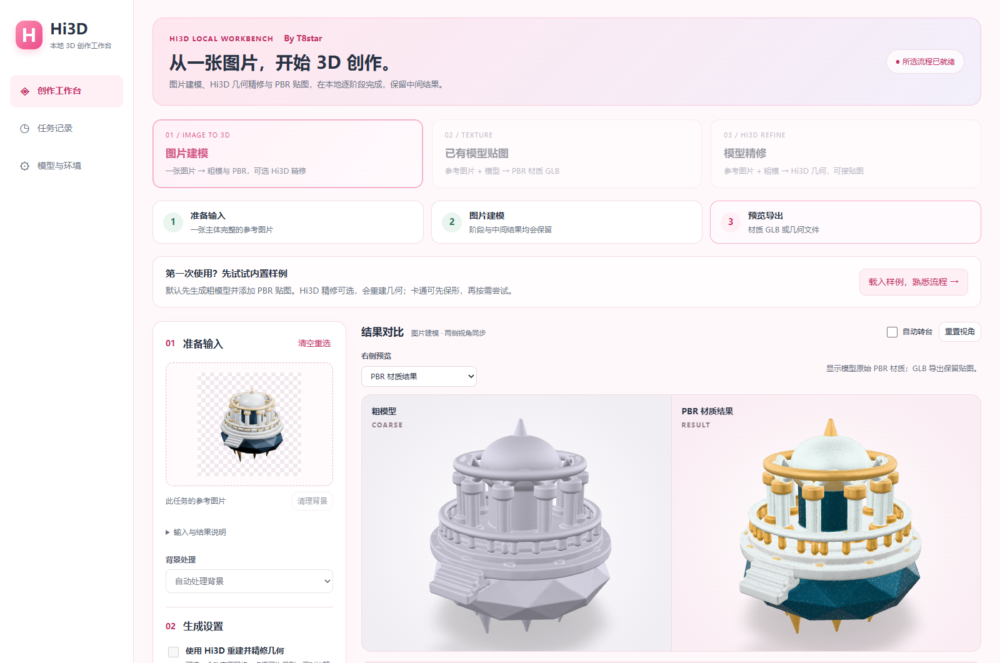

# Hi3D 本地工作台 / ComfyUI-Hi3D

## v0.3.0 资产工作台

新增功能只进入独立整合包。ComfyUI 的三个节点与原有画布工作流继续只做 Hi3D 几何精修。

| 入口 | 输入与处理 | 输出 |
| --- | --- | --- |
| 图片建模 | 图片→U2Netp 前景→Hunyuan2mini-Turbo→可选 Hi3D→可选 TRELLIS.2 PBR | 基础、精修、材质版本分别保存 |
| 已有模型贴图 | 参考图＋GLB/PLY/STL→TRELLIS.2 对实际网格生成 UV/PBR | 内嵌颜色、金属度/粗糙度贴图的 GLB |
| 模型精修 | 参考图＋粗模→Hi3D，可选继续贴图 | 几何与材质版本分别导出 |



透明图片直接使用 alpha；普通图片可自动处理前景，也可选择保留背景或手工擦除。STL/PLY 仅含几何。目标 Z 高度只缩放导出副本，不覆盖任务原件。每段使用独立进程串行运行，保留中间模型、参数、日志与阶段报告；停止、失败或重启后不会自动重跑昂贵推理。复用会新建任务。

图片建模默认 **基础模型＋PBR**，无需上传粗模；Hi3D 精修可勾选。真实同图卡通对照中，跳过精修的嘴部更干净、衣服颜色更接近参考；保留两版供对比，不把更多面数当作必然改善。贴图条件来自最终选用网格，而不是旧基础模型的 latent。

默认采用 **512 贴图采样／2048 贴图、开启省显存**；1024／4096 属于高档。RTX 5090 Laptop 24GB／64GB RAM 实测：

| 案例 | 耗时 | PyTorch 分配峰值 | NVML 整卡峰值 |
| --- | --- | --- | --- |
| 兔子图片→Hunyuan 基础网格256／5步 | 51.817秒 | 2468.37MiB | 未单独采集 |
| 新生成并精修的兔子→PBR512／2048 | 92.084秒 | 2842.29MiB | 验证期3976.199MiB |
| 已有机械网格→PBR1024／4096 | 258.948秒 | 6763.41MiB | 11560.707MiB |

NVML 包含驱动、桌面和其他进程，以上不构成最低显存保证；尚无 6／8／12GB 真卡验收。模型冷启动、校验、网格面数与 UV 展开都会影响总时长，复杂建筑可能比角色更慢。完整目录约 34GiB，另需预留缓存和任务空间；使用包内运行时不需另装 Python 或 CUDA Toolkit。

当前 Windows 预编译贴图扩展的必要架构条件是 **CUDA 计算能力≥8.6**；RTX 20 系列与 A100（8.0）不适用于这套扩展，程序会在加载贴图模型前明确提示。达到该架构条件不代表显存足够或该型号已验收；图生基础网格与原 Hi3D 的限制分别处理。

带 UV 网格的拓扑检查只在临时副本中合并完全相同坐标的接缝顶点，避免把 UV 岛误报为几何碎片；原 GLB 不被修改。这不修复真正开口，也不证明可打印。生成的背面、细纹与色彩可能偏离单张参考图。

Hi3D 核心仍使用原 `.venv` / `runtime`。新增组件使用 **Python 3.12 / Torch 2.8 cu128** 的 `.pipelineenv` / `runtime-pipeline`，不安装进 ComfyUI 的 Python。

完整包启动器只在自身进程中清除宿主 Python／CUDA 环境变量，指定包内 TCC 编译器，将内核缓存放到 `data/kernel-cache`；不修改系统环境。

源码部署在已有 Hi3D 安装完成后，使用 Python 3.12 执行：

```powershell
C:/Python312/python.exe tools/setup_pipeline_runtime.py
.appenv/Scripts/python.exe -m hi3d_workbench.pipeline_models download
```

第二条命令也可用装有工作台依赖的 Python 执行。模型位于 `models/extensions`；界面「模型与环境」可分别补齐建模/贴图组件并校验。DINOv3 使用经过官方文件哈希比对的 camenduru 公开分发版本，保留 Meta 原许可与来源，不加载模型仓库的远程 Python 代码。

**验收状态**：154 项回归、17 组明确浏览器夹具与 7 组真实 UI 检查通过。开发和随包运行时各 6 项 CUDA 算子通过；三个工作台入口、取消后复用、完整图片三阶段、80mm 保材质导出均已用真实模型验收。15 个旧任务与358文件无覆盖保留。真实效果仍有嘴眼伪细节、色差和背面推测等局限。见[完整证据](../validation/asset-pipeline-progress.md)与 [roadmap.md](../roadmap.md)。

## v0.2.2 几何精修版（此前已发布）

**By T8star · v0.2.2**。采用与 IndexTTS 工作台协调的粉白配色，提供「准备输入 → 开始精修 → 对比导出」三步引导。本次完成 20 轮联合检查与错误恢复修复，详见 [审计记录](../validation/postpublish-audit20.md) 和 [更新说明](CHANGELOG.md)。

本项目只接入 Hi3D V1.0。输入为同一物体的参考图和粗网格，输出纯几何。独立工作台提供输入预览、手工透明蒙版、512/1024/1536 精修、CPU 卸载、同步 3D 对比、任务日志、几何检查和 GLB/PLY/STL 导出。默认 512、25 步、固定 seed、开启卸载，不自动降档。

**本机启动**

解压完整 Windows 包后，双击 `Start-Workbench.cmd`，访问启动后的 [本地工作台](http://127.0.0.1:8378)。界面仅监听本机回环地址。建议解压到较短路径，例如 `E:/Hi3D`；完整目录约 16GB，另需为输入、输出及首次内核缓存预留空间。需要 NVIDIA 驱动；不需要另外安装 Python 或 CUDA Toolkit。

首次安装 Windows 源码版使用 Python 3.10：

```powershell
powershell -ExecutionPolicy Bypass -File scripts/Setup.ps1 -Python C:/Python310/python.exe -DownloadModels
```

解压带 runtime 的发行目录可直接启动。带 models 的离线目录无需联网下载；所有推理加载器强制使用本地文件。源码小包需要在线准备环境和权重。不要把只有源码的小包称为完整离线包。

Linux 官方路径运行 `bash scripts/setup-linux.sh`，然后运行 `.venv/bin/python -m hi3d_workbench.model_cli download` 与 `.venv/bin/python -m hi3d_workbench --open`。Linux 脚本以官方 Ampere/Hopper 测量栈为基础，Blackwell 不应套用旧版 torch/cu124。

**使用流程**

1. 等待页头显示「本地模型已就绪」。完整包首次解压或移动后会自动校验文件；缺失时在「模型与环境」下载 / 补齐，GPU 报错时可运行诊断。
2. 准备输入：上传图片及同一物体的 GLB/PLY/STL 粗网格，也可点击「载入样例，熟悉流程」。透明背景有助于正确取景；可手工清理，不依赖抠图模型。多图不能拼图冒充原生多视图推理。
3. 开始精修：新手保留 512 档和省显存模式，点击「开始 Hi3D 精修」。25 步、种子和 Attention 后端在高级设置里。解码和提取阶段不显示虚构百分比，日志和真实阶段会更新。
4. 对比导出：旋转检查原粗模与精修，选择更好的版本导出，可设置 Z 轴目标高度（毫米）。STL 配套下载尺寸说明，并在切片器核对尺度。历史任务点击「复用这次输入和参数」，即可调整后新建任务；原记录保留。

指定目标高度后，STL/PLY 以毫米坐标导出；GLB 按 [glTF 规范的米制单位](https://registry.khronos.org/glTF/specs/2.0/glTF-2.0.html#coordinate-system-and-units) 换算，80mm 对应 0.08m。尺寸说明保留输入的毫米值和实际坐标单位。未指定高度时保留归一化坐标，不宣称真实物理尺寸。

**ComfyUI**

将节点包解压至 `custom_nodes`，或运行 `scripts/Install-ComfyUI.ps1 -ComfyUI <ComfyUI根目录>`。安装 node-side requirements.txt；不替换 ComfyUI 的 torch。先启动工作台后端，再将 `examples/Hi3D-Refine.json` 拖入 ComfyUI 画布。发布示例仅提供画布工作流，使用「保存工作流」保留节点位置与连线。

连接：Hi3D Backend → Hi3D Load Mesh；Load Image 的 IMAGE/MASK 与 MESH → Hi3D Refine → 原生 SaveGLB。只包含 Hi3D 节点，没有其他 3D 模型。节点接受原生 MESH，支持单物体并按 vertex_counts/face_counts 剔除 padding。参考图 MASK 按 ComfyUI 的 1=遮蔽约定转换 alpha。推理前请求 ComfyUI 卸载模型；中断会请求后端停止，结果和日志可在工作台中查看。

**推理模式与效果范围**

- Linux `flash`：使用官方 FlashAttention 实现与官方采样/后处理。
- Windows `sdpa`：明确标识的兼容移植，用 PyTorch 融合 SDPA 执行同样的 packed attention。仅修改当前 worker 内函数绑定，保留原权重、预处理、步数和后处理。禁止退到 CUDA 上的 N×N math attention。它不等于官方已验证环境。
- 目前没有增加其他粗模生成器、纹理生成器或第二精修模型。

本机 RTX 5090 Laptop 24GB / 64GB RAM 已完成真实 512 ComfyUI 推理与 1024 工作台推理，分别约 234 秒和 951 秒；同一流程样例的 PyTorch 张量分配峰值分别为 1722MiB 和 8033MiB。独立运行时的离线 512 推理约 242 秒；1536 三轮完整离线推理约 2390 秒，张量峰值 15555MiB、保留峰值 17906MiB。张量分配不包含 CUDA 上下文和驱动显存，不能据此认定 2GB/8GB GPU 可运行。CPU 卸载会占用较多系统内存；本次使用 64GB RAM，未验证低内存电脑。其他显卡型号与容量没有真实验收；详见 [VALIDATION.md](../VALIDATION.md)。

Hi3D 会归一化尺寸、重新生成拓扑和删除部分小连通件；不生成 UV、材质或纹理，不保证可打印或动画即用。检查报告中的“未检测”项目不会标为通过。样例是流程验收输入，不是美术或精度基准；更高分辨率不必然更准确，应比较并保留原粗模。

**本地文件与可追溯性**

`data/assets` 保存上传工件；`data/jobs/<id>` 保存输入、请求、日志、条件图、结果和报告；`data/exports` 保存不覆盖原件的导出。模型清单在 `models/manifest.json`，记录每个组件的 revision、SHA256、文件大小和许可。每次任务会校验完整权重，报告记录源码版本、模型清单哈希、输入哈希、GPU、依赖版本、实际分辨率、时间和显存。取消或失败不会产生成功记录。当前无中间状态续跑，重试是新任务。

配置可复制 `config.example.json` 为 `config.local.json`。`worker_python` 指定独立推理解释器；`worker_command` 是受信任的本地管理员配置，不接受 HTTP 编辑。API 不支持任意 shell 执行。端口默认 8378。为保证浏览器与 ComfyUI 间精确重现，seed 范围为 0–9007199254740991。

模型下载默认沿用系统代理。若代理导致大文件 TLS 连接停滞，可在本项目配置设置 `download_trust_env: false` 使用直连；`download_workers` 控制并发，默认 6。它们只作用于本项目的权重传输，不修改系统代理。下载使用 4MiB 分段，校验 Content-Range、片段长度和完整 SHA256。

**开发验证与发行**

```powershell
python -m pytest -q
python tools/make_sample.py
python tools/browser_qa.py
python tools/build_release.py
python tools/build_release.py --portable-base C:/Python310 --include-models
```

浏览器 QA 使用本机 Chrome 与 Playwright；核心测试在临时目录隔离运行。测试的 worker 替身仅验证任务取消等控制流程，不计为模型实测。真实推理证据另外保存，见 `VALIDATION.md`。

发行包排除模型缓存、个人输入、任务、研究文档和上游未授权示例媒体。ZIP 文件的大小和 SHA256 记录在 `SHA256.json`；完整 Windows 目录包含独立 Python、依赖和固定版本权重，不借用开发机其他 ComfyUI 环境。`validation/` 保留本次实际报告和界面截图。所有更新以新目录发布，不覆盖已有环境。

许可与署名见 [NOTICE.md](NOTICE.md) 及随包上游许可。社区集成；[Powered by Hi3D 1.0](http://hi3d.ai/)。
